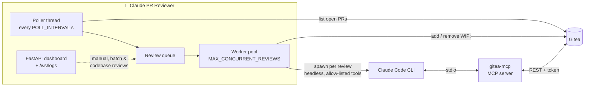

<div align="center">

# 🤖 Claude PR Reviewer for Gitea

### A senior code reviewer for your self-hosted Gitea, powered by Claude Code.

Open a pull request and Claude reads the diff **with full file context**, finds bugs, security holes and code-quality problems,<br>
then posts **inline comments** and a **structured summary** right on the PR. No webhooks, no admin access, no inbound ports.

[](https://www.python.org/)
[](https://docs.anthropic.com/en/docs/claude-code)
[](https://gitea.io)
[](https://gitea.com/gitea/gitea-mcp)
[](#%EF%B8%8F-dashboard)
[](#-quick-start-docker)
[](https://github.com/Pranav-Conova/code-review-workflow-for-local-gitea/stargazers)

[**Quick start**](#-quick-start-docker) · [**What it does**](#-what-it-does) · [**Review modes**](#-three-kinds-of-review) · [**How it works**](#%EF%B8%8F-how-it-works) · [**Dashboard**](#%EF%B8%8F-dashboard) · [**Configuration**](#%EF%B8%8F-configuration) · [**Troubleshooting**](#-troubleshooting)

</div>

---

## 🤔 Why?

Hosted platforms have AI review bots. A Gitea instance on your laptop, your LAN or behind a VPN usually doesn't, and wiring one up normally means webhooks, admin rights and opening ports.

**Claude PR Reviewer just polls.** It uses an ordinary access token, asks the Gitea API for open PRs, and reviews the new ones.

- 🔍 **Real context**: Claude reads the *whole* changed file, not only the diff, so it catches problems a diff alone hides.
- 💬 **Feedback where it belongs**: line-by-line comments on the PR, plus one summary grouped by severity.
- 🚦 **Visible progress**: the PR title gets a `WIP:` prefix while the review runs and loses it when the review is done.
- 🔒 **Locked down**: Claude runs headless with an explicit tool allow-list. It can read repos and post review comments through the Gitea MCP server, nothing else.
- 🖥️ **A dashboard**: watch reviews and live logs, trigger reviews by hand, or pause the poller.

## ⚡ Quick start (Docker)

Docker bundles Claude Code, Go, the Gitea MCP server and Python. Only Docker is needed on the host.

**1. Get your Claude OAuth credentials**

```bash
cat ~/.claude/.credentials.json   # copy accessToken and refreshToken from "claudeAiOauth"
```

**2. Create a Gitea access token** under **Settings → Applications → Manage Access Tokens**, with `repo` read/write scope.

**3. Create `.env` in the project root** (see [`.env.example`](.env.example))

```env
CLAUDE_TOKEN=sk-ant-oat01-...
CLAUDE_REFRESH_TOKEN=sk-ant-ort01-...
GITEA_TOKEN=your-gitea-access-token
GITEA_HOST=http://host.docker.internal:3000

# docker-compose publishes port 7000, so serve the dashboard there
DASHBOARD_PORT=7000
```

**4. Build and run**

```bash
docker compose -f docker/docker-compose.yml up -d --build
docker logs -f claude-pr-reviewer
```

Open **http://localhost:7000** for the dashboard. Open a PR in Gitea and watch the review arrive.

> If Gitea runs on the same machine, `localhost` inside the container is the container itself. Use your machine's address (or `host.docker.internal` where supported) for `GITEA_HOST`.

<details>
<summary><b>Run without Docker</b></summary>

You need the [Claude CLI](https://docs.anthropic.com/en/docs/claude-code) (logged in), [Go 1.21+](https://go.dev/dl/) for the Gitea MCP server, and Python 3.10+.

```bash
export GITEA_TOKEN='your-gitea-access-token'
export GITEA_HOST='http://localhost:3000'

bash setup.sh                       # writes .mcp.json and Claude tool permissions

python3 -m venv env && source env/bin/activate
pip install -r requirements.txt

python3 src/app.py                  # dashboard on :8000 + poller
```

Set `DASHBOARD_ENABLED=false` to run only the poller with no web UI. A `.env` file in the project root is loaded automatically.

</details>

## ✨ What it does

| | Feature | Details |
|---|---|---|
| 🔁 | **Automatic polling** | Checks every repo the token can see, every `POLL_INTERVAL` seconds, and queues PRs it hasn't reviewed yet. |
| 📖 | **Full-context reviews** | Reads the diff plus the full base and head versions of each changed file through the Gitea MCP server. |
| 💬 | **Inline comments** | Posts findings on the exact lines, each with a severity and a concrete code suggestion. |
| 📋 | **Structured summary** | One review comment grouping findings into **critical**, **warning**, **suggestion** and **nitpick**. |
| 🚦 | **WIP indicator** | Prefixes the PR title with `WIP:` during review and restores it afterwards, even if the review fails. |
| ⚙️ | **Parallel reviews** | A worker pool runs up to `MAX_CONCURRENT_REVIEWS` Claude sessions at once. |
| 🧩 | **Batch & codebase reviews** | Review several PRs together for integration issues, or whole repositories for architecture problems. |
| 🖥️ | **Web dashboard** | Review history, live log stream, manual triggers and a poller on/off switch. |
| ⌨️ | **Interactive mode** | A `/review-pr` skill for running a review by hand inside Claude Code. |

## 🧭 Three kinds of review

| Mode | Input | What Claude looks for | Where results go | Timeout |
|---|---|---|---|---|
| **PR review** | One PR (automatic or manual) | Bugs, security issues, quality, edge cases | Inline comments + summary on the PR | 10 min |
| **Batch review** | 2+ PRs, across repos | Conflicts and integration problems between the changes | Posted to Gitea | 15 min |
| **Codebase review** | 1+ whole repositories | Systemic and architectural issues, missing tests, cross-repo concerns | Dashboard only, **not** posted to Gitea | 20 min |

## ⚙️ How it works



1. **Poll**: the poller lists open PRs across every accessible repo and skips any already recorded in `data/reviewed.json` (keys like `owner/repo#12`).
2. **Queue**: new PRs go onto a queue. Worker threads pick them up, up to `MAX_CONCURRENT_REVIEWS` at a time.
3. **Review**: each job starts a headless Claude Code session with a review prompt and an explicit `--allowed-tools` list. Claude uses the Gitea MCP server to read the diff and files and to post comments.
4. **Finish**: the `WIP:` prefix is removed, the result is saved to the review history, and the PR is marked as reviewed.

## 🖥️ Dashboard

`python3 src/app.py` serves the dashboard and runs the poller in the same process.

| Method | Path | What it does |
|---|---|---|
| `GET` | `/` | Dashboard UI |
| `GET` | `/api/status` | Poller state, queue and worker info |
| `POST` | `/api/poller/toggle` | Pause or resume automatic polling |
| `GET` | `/api/reviews` | Review history |
| `POST` | `/api/reviews/trigger` | Queue one PR for review |
| `GET` / `POST` | `/api/batch-reviews` | List or start a multi-PR integration review |
| `GET` / `POST` | `/api/codebase-reviews` | List or start a whole-repo review |
| `WS` | `/ws/logs` | Live log stream |

## ⚙️ Configuration

All settings are environment variables, or a `.env` file in the project root.

| Variable | Default | Description |
|---|---|---|
| `GITEA_TOKEN` | *(required)* | Gitea personal access token (`repo` read/write) |
| `GITEA_HOST` | `http://localhost:3000` | Your Gitea URL |
| `CLAUDE_TOKEN` / `CLAUDE_REFRESH_TOKEN` | *(required in Docker)* | Claude OAuth tokens |
| `POLL_INTERVAL` | `10` | Seconds between poll cycles |
| `MAX_CONCURRENT_REVIEWS` | `2` | Parallel Claude sessions |
| `DASHBOARD_ENABLED` | `true` | `false` runs the poller only |
| `DASHBOARD_HOST` / `DASHBOARD_PORT` | `0.0.0.0` / `8000` | Dashboard bind address (use `7000` with the provided compose file) |
| `CLAUDE_BINARY` | `claude` | Path to the Claude CLI |
| `LOG_LEVEL` | `DEBUG` | `DEBUG`, `INFO`, `WARNING` or `ERROR` |
| `PROJECT_DIR` | auto-detected | Project root |
| `DATA_DIR` | `<PROJECT_DIR>/data` | Logs, review history and reviewed-PR list |

### Re-reviewing PRs

Remove a PR's key from `data/reviewed.json` (or delete the file to re-review everything), or use **trigger review** on the dashboard. In Docker: `docker exec claude-pr-reviewer rm /app/data/reviewed.json`.

## 🗂 Project structure

```text
code-review-workflow-for-local-gitea/
├── src/
│   ├── app.py               entry point: FastAPI dashboard + poller thread
│   ├── poller.py            Gitea API client, poll loop, queue, workers, WIP titles
│   ├── reviewer.py          spawns headless Claude Code sessions (PR, batch, codebase)
│   ├── prompt_template.py   review prompts for each mode
│   ├── api.py               dashboard REST endpoints + /ws/logs
│   ├── state.py             review history and batch/codebase review state
│   ├── log_handler.py       streams logs to the dashboard over WebSocket
│   ├── config.py            environment variables
│   ├── templates/           dashboard HTML
│   └── static/              dashboard CSS
├── docker/                  Dockerfile (Node + Go + Python), compose file, entrypoint
├── .claude/skills/review-pr/  /review-pr skill for interactive reviews
├── setup.sh                 local setup: .mcp.json + Claude permissions
└── .env.example
```

## 🩺 Troubleshooting

| Problem | Fix |
|---|---|
| Dashboard not reachable in Docker | Set `DASHBOARD_PORT=7000` in `.env` to match the published port |
| `ERROR: Set GITEA_TOKEN` | Set it in the environment or `.env` |
| `ERROR: Go not found` (local) | Install Go from [go.dev/dl](https://go.dev/dl/) |
| MCP server fails to start | Check that `GITEA_HOST` is reachable and the token is valid |
| First review is slow | Normal: Go downloads the Gitea MCP module on first run |
| Reviews not posting | The Gitea token needs write access to the repository |
| No PRs found | Check `data/review.log` or the dashboard logs for API errors |
| Permission prompts in Claude (local) | Re-run `bash setup.sh` |

## 🗺️ Ideas

- [ ] Re-review automatically when new commits are pushed to a PR
- [ ] Per-repo rules and ignore lists
- [ ] Optional webhook mode for instant reviews

## 🧰 Built with

[Claude Code](https://docs.anthropic.com/en/docs/claude-code), [gitea-mcp](https://gitea.com/gitea/gitea-mcp), [FastAPI](https://fastapi.tiangolo.com), [Uvicorn](https://www.uvicorn.org), Docker

## 📄 License

MIT

---

<div align="center">

If this caught a bug before your teammates did, a ⭐ helps other people find it.

</div>
